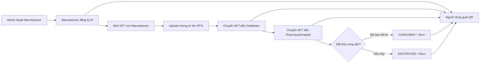
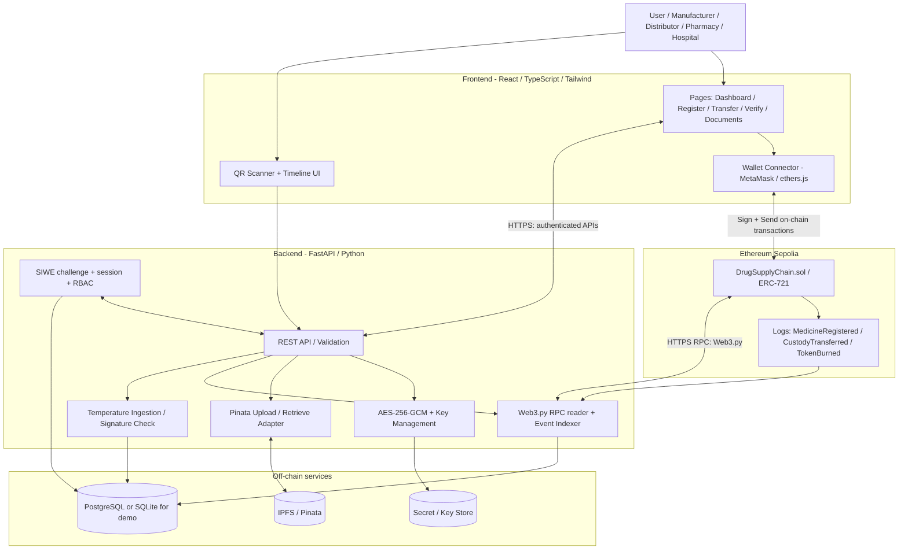
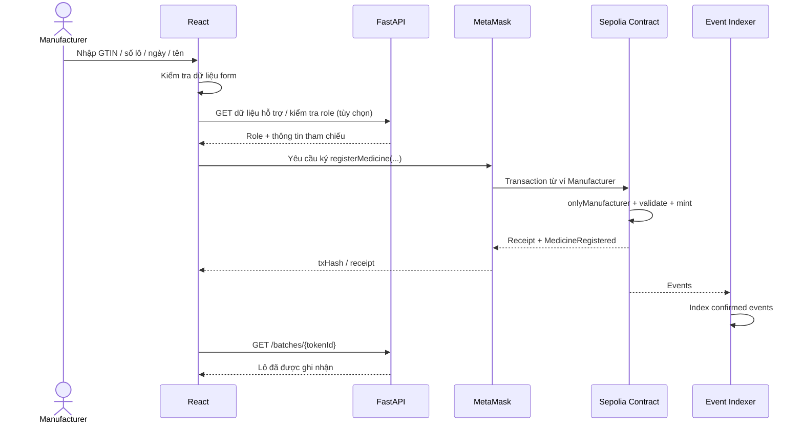
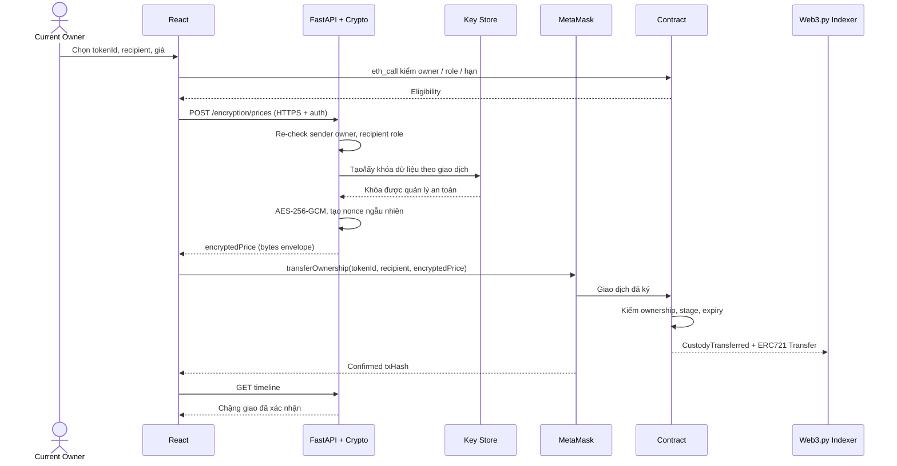
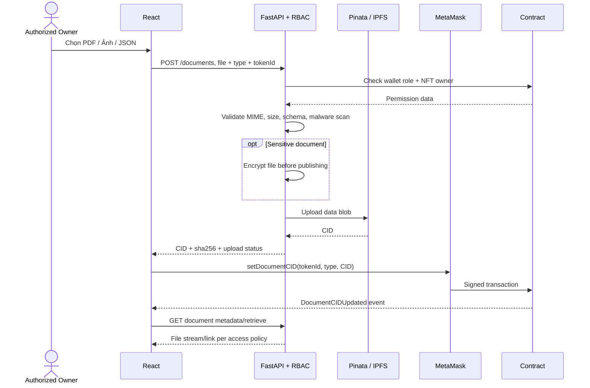
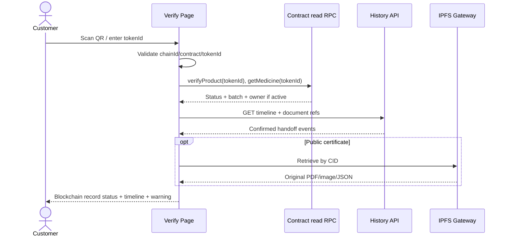
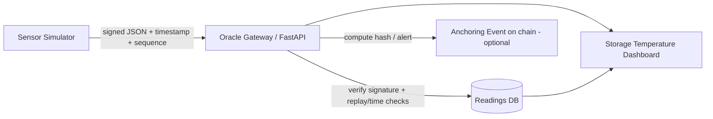

# THIẾT KẾ HỆ THỐNG WEB DAPP TRUY XUẤT NGUỒN GỐC CHUỖI CUNG ỨNG THUỐC

> **Tên dự án:** Drug Supply Chain Traceability (DSCT)  
> **Phiên bản:** System Design v1.0 — 29/10/2026  
> **Đối tượng:** Nhóm phát triển Frontend, Smart Contract, Backend/Security và giảng viên đánh giá  
> **Trạng thái:** ĐẶC TẢ THIẾT KẾ — không phải xác nhận đã phát triển, kiểm thử hoặc triển khai  
> **Mô hình:** Web DApp responsive + Ethereum Sepolia + ERC-721 + IPFS/Pinata + FastAPI/Web3.py

## 0. Cơ sở thiết kế và cách đọc tài liệu

### 0.1. Tài liệu nguồn

1. `YeuCauDeTai_Blockchain.docx`: Bài tập 03 — *Truy xuất nguồn gốc chuỗi cung ứng thuốc* theo định hướng MediLedger; chỉ định các nghiệp vụ `registerMedicine`, `transferOwnership`, `verifyProduct`, `burnToken`, `verifyAuthenticity`, môi trường Sepolia, QR, AES, IPFS/Pinata, Oracle.
2. `Rubik_Blockchain.xlsx`, sheet `Sheet1`, vùng `A1:H28`: bảng tiêu chí, mô tả và các yêu cầu định lượng về Smart Contract, DApp, IPFS, Token và Báo cáo & Thuyết trình.

**Phân biệt nguồn và lựa chọn thiết kế:** Những nội dung ghi **[BẮT BUỘC]** là yêu cầu được nêu trong hai tài liệu. Những nội dung ghi **[THIẾT KẾ ĐỀ XUẤT]** (React, FastAPI, PostgreSQL, SIWE, cơ chế mã hóa, schema, API...) là giải pháp của nhóm nhằm đáp ứng yêu cầu, không phải quy định bắt buộc của giảng viên.

**Lưu ý chênh lệch thang điểm:** Đề bài Word có **4 tiêu chí kỹ thuật × 10 = 40 điểm**. Rubric Excel có **5 tiêu chí × 10 = 50 điểm**, bổ sung *Báo cáo & Thuyết trình*. Nhóm phải theo dõi **cả 5 tiêu chí** của rubric để không bỏ sót điểm.

### 0.2. Mục đích sản phẩm

Hệ thống cho phép nhà sản xuất đăng ký lô thuốc có định danh NFT, chuyển giao quyền quản lý qua các đơn vị được cấp quyền và công khai hành trình phục vụ truy xuất. Các chứng từ PDF/ảnh/JSON được lưu bằng IPFS; Smart Contract giữ CID và trạng thái pháp lý-kỹ thuật do các bên khai báo. Người dùng quét QR để xem nguồn gốc, chủ sở hữu, tình trạng hạn sử dụng và hành trình giao nhận.

**Giới hạn của minh chứng blockchain:** Smart Contract xác minh tính nhất quán của **hồ sơ số và người ký giao dịch**; hệ thống **không tự chứng minh** hộp thuốc vật lý là thật, cảm biến không bị giả mạo hay nhà sản xuất đã khai báo trung thực. Đây là phần phải giải thích trong báo cáo và demo Oracle.

### 0.3. Phạm vi MVP (bản nộp đồ án)

- **[BẮT BUỘC]** 3 nghiệp vụ trọng tâm: đăng ký, chuyển giao, xác minh; tối thiểu 2 ràng buộc logic; chạy trên Sepolia.
- **[BẮT BUỘC]** DApp tối thiểu 3 tương tác on-chain, quét QR giả lập hoặc camera, Dashboard Track & Trace.
- **[BẮT BUỘC]** Mã hóa giá giao dịch trước khi ghi lên chuỗi; minh họa giải mã bởi bên có quyền.
- **[BẮT BUỘC]** IPFS: ít nhất 3 loại (PDF, ảnh, JSON), 2 thao tác (upload, retrieve), kiểm soát truy cập theo vai trò.
- **[BẮT BUỘC]** Một ERC-721 NFT cho mỗi lô, mint, burn và xác minh owner.
- **[BẮT BUỘC]** Kiểm thử và demo: tối đa một giao dịch lỗi trong buổi trình diễn theo rubric; có tài liệu, hình/bảng có caption, bảng viết tắt và nguồn tham khảo.
- **[THIẾT KẾ ĐỀ XUẤT]** Một NFT đại diện **một lô thuốc nguyên vẹn**, không phải từng hộp; chỉ hỗ trợ chuyển lô toàn phần. Chia lô, thanh toán thật, logistics GPS thật và hệ thống kiểm định nhà nước là ngoài phạm vi MVP.
- **[THIẾT KẾ ĐỀ XUẤT]** Giữ hai vai trò nơi nhận cuối: `PHARMACY`, `HOSPITAL`; cả hai có thể tiếp nhận và kết thúc vòng đời lô.

---

## 1. Phân tích tác nhân và nghiệp vụ

### 1.1. Các tác nhân

| Tác nhân | Ký hiệu | Chức năng | Quyền kiểm soát |
|---|---|---|---|
| System Admin | ADMIN | Cấp/thu hồi vai trò, khóa thành viên, xem log | Không tự ý sở hữu/đốt NFT của thành viên |
| Nhà sản xuất | MANUFACTURER | Đăng ký lô, mint NFT, upload chứng từ, bàn giao cho Distributor | Chỉ ví được admin xác thực mới được `registerMedicine` |
| Nhà phân phối | DISTRIBUTOR | Nhận NFT, xem chứng từ theo quyền, chuyển cho Pharmacy/Hospital | Phải đang là chủ NFT và lô còn hạn |
| Nhà thuốc | PHARMACY | Nhận NFT, kiểm chứng, ghi nhận bán hết lô/tiêu hủy | Chỉ hành động trên lô do chính mình sở hữu |
| Bệnh viện | HOSPITAL | Tương tự Pharmacy | Chỉ hành động trên lô do chính mình sở hữu |
| Người mua/khách | PUBLIC | Quét QR, đọc nguồn gốc công khai, xem trạng thái | Không có quyền ghi on-chain hay lấy chứng từ mật |
| Oracle/Sensor gateway | ORACLE | Gửi bản ghi nhiệt độ có chữ ký và chứng cứ nguồn | Không thay đổi chủ sở hữu thuốc |

### 1.2. Quy trình nghiệp vụ chuẩn



**Chú ý:** Trong mô hình NFT theo lô, `CONSUMED` có nghĩa **toàn bộ lô đã hoàn tất bán lẻ/phát thuốc**. Nếu bán từng hộp, không được burn NFT ngay ở hộp đầu tiên; cần thiết kế quản lý số lượng hoặc serial riêng ở phiên bản sau.

### 1.3. Trạng thái và quy tắc chuyển giao

- `LifecycleStatus`: `ACTIVE` (0), `CONSUMED` (1), `DESTROYED` (2).
- `EXPIRED` là **trạng thái hiệu lực được tính động**: `block.timestamp >= expiryDate`; không phải trạng thái cần transaction cập nhật.
- `CustodyStage`: `AT_MANUFACTURER`, `AT_DISTRIBUTOR`, `AT_DISPENSER`. Hai vai trò PHARMACY/HOSPITAL cùng thuộc `AT_DISPENSER`.
- Chuyển giao hợp lệ: `MANUFACTURER -> DISTRIBUTOR` hoặc `DISTRIBUTOR -> PHARMACY/HOSPITAL`. Không hỗ trợ chuyển ngược hoặc chuyển giữa các distributor trong MVP.
- `CONSUMED` và `DESTROYED` là trạng thái cuối; không cho phép chuyển giao, mint lại cùng định danh, hay dùng NFT đã burn để chứng minh quyền hiện tại.
- Lô hết hạn: **chặn chuyển giao/bán**; vẫn có thể thực hiện quy trình **tiêu hủy** nếu được cấp quyền.

---

## 2. Kiến trúc toàn hệ thống và ranh giới tin cậy

### 2.1. Sơ đồ các thành phần



### 2.2. Trách nhiệm từng tầng

| Tầng | Nhiệm vụ | Được phép làm | Không được làm |
|---|---|---|---|
| React | Giao diện, nhập form, quét QR, hiển thị trạng thái và lịch sử | Kết nối ví, ký transaction, gọi REST, đọc RPC công khai | Chứa `PINATA_JWT`, private key, AES master key trong bundle |
| MetaMask + ethers.js | Ký giao dịch của từng thành viên trên máy người dùng | Gọi `registerMedicine`, `transferOwnership`, `burnToken`, `setDocumentCID` | Gửi private key sang backend |
| Solidity | Nguồn chân lý cho quyền sở hữu NFT, vai trò, vòng đời, CID đã ghi | Kiểm tra `msg.sender`, hạn sử dụng, giai đoạn, phát sự kiện | Lưu plaintext giá, PDF hoặc khóa mã hóa |
| FastAPI | REST, xác thực quyền truy cập, mã hóa, upload/retrieve, Oracle | Xác minh chữ ký login, kiểm tra RBAC, quản lý Pinata token | Tự đại diện ký giao dịch của user nếu không có cơ chế ủy quyền minh bạch |
| Web3.py | Đọc chain, events, receipt, `eth_call`, lập chỉ mục | Đọc owner, status, lịch sử, tình trạng transaction | Quyết định ownership thay contract |
| PostgreSQL/SQLite | Cache/index, log backend, nonce và trạng thái đồng bộ | Phân trang, tìm kiếm nhanh, dựng Timeline | Được xem là nguồn chân lý on-chain |
| IPFS | Lưu blob có content address | Lưu PDF/ảnh/JSON hoặc ciphertext của file | Tự bảo đảm quyền đọc dữ liệu gốc |
| Key Store | Giữ secret và quyền giải mã | Cấp khóa có kiểm soát | Lưu key công khai trên chain/IPFS/frontend |

**Lựa chọn kết nối:** Các transaction cập nhật NFT được ký trực tiếp ở browser qua MetaMask. Backend sử dụng Web3.py cho truy vấn, đối chiếu, lập chỉ mục và các tác vụ ngoài chuỗi. Như vậy hệ thống **có Web3.py** theo yêu cầu, đồng thời không cần giữ private key của Manufacturer/Distributor/Pharmacy trên server. Không bắt frontend buộc phải gửi giao dịch qua FastAPI; lựa chọn đó khó quản lý signer hơn.

### 2.3. Trên chuỗi so với ngoài chuỗi

| Dữ liệu | Vị trí | Lý do |
|---|---|---|
| `tokenId`, GTIN, số lô, nhà sản xuất, hạn dùng, trạng thái | Smart Contract | Kiểm chứng và không phụ thuộc DB |
| `ownerOf(tokenId)` khi NFT còn tồn tại | ERC-721 | Nguồn xác thực chủ sở hữu hiện tại |
| CID giấy chứng nhận, CID metadata | Smart Contract | Cam kết tham chiếu nội dung |
| Lịch sử chuyển giao | Ethereum Events; DB cache bản sao | Truy xuất đầy đủ; tránh mảng lớn tốn gas |
| Giá giao dịch đã mã hóa | `CustodyTransferred` event dưới dạng `bytes` | Không lộ plaintext, vẫn có chứng cứ on-chain |
| Giá plaintext, khóa AES | Chỉ ở phía có quyền; khóa trong Key Store | Tuyệt đối không công khai |
| PDF CO, ảnh kiểm định, metadata thành phần | IPFS/Pinata | Giảm chi phí lưu on-chain |
| Bảng tra nhanh, dữ liệu biểu đồ UI | Backend DB | Truy vấn nhanh và phân trang |
| Nhật ký cảm biến chi tiết | DB riêng/ngoài chuỗi; hash neo on-chain nếu cần | Oracle có nguồn chứng cứ kiểm tra |

---

## 3. Thiết kế Smart Contract

### 3.1. Chuẩn và mô-đun

**[THIẾT KẾ ĐỀ XUẤT]** Một contract `DrugSupplyChain.sol` kế thừa ERC-721, AccessControl và hỗ trợ burn có kiểm tra nghiệp vụ. Sử dụng thư viện OpenZeppelin có phiên bản được **pin** trong dependency, không sao chép tùy tiện code ERC-721. Code interface được version hóa theo `interfaces/IDrugSupplyChain.sol`.

- `DEFAULT_ADMIN_ROLE`: tài khoản quản trị cấp/thu hồi quyền.
- `MANUFACTURER_ROLE`, `DISTRIBUTOR_ROLE`, `PHARMACY_ROLE`, `HOSPITAL_ROLE`: kiểm soát nghiệp vụ.
- Chặn đường chuyển NFT ngoài quy trình nghiệp vụ (các hàm ERC-721 công khai như `transferFrom`, `safeTransferFrom`, approvals) bằng chiến lược hook/override phù hợp phiên bản OpenZeppelin đang dùng; **không được chỉ kiểm tra trong `transferOwnership()` rồi để các đường khác bypass**.
- Mỗi bộ định danh `(manufacturer, gtin, batchNumber)` chỉ được dùng một lần, kể cả sau burn. `tokenId` là bộ đếm tăng tuần tự; `batchKey = keccak256(abi.encode(manufacturer, gtin, batchNumber))` chống trùng.
- NFT burn nhưng **không xóa hồ sơ lịch sử**; dùng bản ghi archive và sự kiện để `verifyProduct` trả được `CONSUMED`/`DESTROYED`.

### 3.2. Data Schema on-chain

```solidity
// Các kiểu minh họa cho đặc tả; file source code sẽ cần triển khai đầy đủ.
enum Role { NONE, MANUFACTURER, DISTRIBUTOR, PHARMACY, HOSPITAL }
enum LifecycleStatus { ACTIVE, CONSUMED, DESTROYED }
enum CustodyStage { AT_MANUFACTURER, AT_DISTRIBUTOR, AT_DISPENSER }
enum DocumentType { CERTIFICATE_OF_ORIGIN, QUALITY_CERTIFICATE, CHEMICAL_METADATA }
enum VerificationStatus { NOT_FOUND, AUTHENTIC, EXPIRED, CONSUMED, DESTROYED, INVALID_OWNER }

struct MedicineBatch {
    uint256 tokenId;
    string gtin;
    string batchNumber;
    string medicineName;
    address manufacturer;
    uint64 manufactureDate;    // Unix seconds
    uint64 expiryDate;         // Unix seconds; valid strictly before this instant
    uint64 registeredAt;
    LifecycleStatus lifecycle;
    CustodyStage stage;
    string metadataCID;
}

struct DocumentRef {
    DocumentType documentType;
    string cid;
    address updatedBy;
    uint64 updatedAt;
}

struct Participant {
    address wallet;
    Role role;
    string organizationName;
    bool active;
}
```

**Chuẩn hóa:** `gtin` là `string`, không phải số nguyên vì có thể có số 0 ở đầu. `tokenId` chuyển sang **string trong JSON/TypeScript**, tránh tràn giới hạn integer an toàn của JS. Tất cả timestamp thống nhất Unix **seconds**. Địa chỉ owner phải lấy từ ERC-721 khi token còn tồn tại; không tạo hai nguồn ownership độc lập.

**Ngoại lệ sau burn:** `ownerOf(tokenId)` sẽ revert. `verifyProduct` và `getMedicine` phải kiểm tra `minted/registered` và `lifecycle` trước; `currentOwner` có thể là `address(0)` đối với token đã burn. `lastOwner` (nếu muốn hiển thị) lấy từ archive hoặc event.

### 3.3. Đặc tả Solidity interface thống nhất với Frontend

```solidity
// SPDX-License-Identifier: MIT
pragma solidity ^0.8.24;

interface IDrugSupplyChain {
    enum Role { NONE, MANUFACTURER, DISTRIBUTOR, PHARMACY, HOSPITAL }
    enum LifecycleStatus { ACTIVE, CONSUMED, DESTROYED }
    enum CustodyStage { AT_MANUFACTURER, AT_DISTRIBUTOR, AT_DISPENSER }
    enum DocumentType { CERTIFICATE_OF_ORIGIN, QUALITY_CERTIFICATE, CHEMICAL_METADATA }
    enum VerificationStatus { NOT_FOUND, AUTHENTIC, EXPIRED, CONSUMED, DESTROYED, INVALID_OWNER }

    struct MedicineBatch {
        uint256 tokenId;
        string gtin;
        string batchNumber;
        string medicineName;
        address manufacturer;
        uint64 manufactureDate;
        uint64 expiryDate;
        uint64 registeredAt;
        LifecycleStatus lifecycle;
        CustodyStage stage;
        string metadataCID;
    }
    struct DocumentRef {
        DocumentType documentType;
        string cid;
        address updatedBy;
        uint64 updatedAt;
    }
    struct Participant {
        address wallet;
        Role role;
        string organizationName;
        bool active;
    }

    event ParticipantUpdated(address indexed wallet, Role role, bool active);
    event MedicineRegistered(uint256 indexed tokenId, address indexed manufacturer, string gtin, string batchNumber);
    event CustodyTransferred(uint256 indexed tokenId, address indexed from, address indexed to, bytes encryptedPrice);
    event DocumentCIDUpdated(uint256 indexed tokenId, DocumentType indexed documentType, string cid, address indexed updatedBy);
    event TokenBurned(uint256 indexed tokenId, address indexed lastOwner, LifecycleStatus finalStatus);

    function setParticipant(address wallet, Role role, string calldata organizationName, bool active) external;
    function getParticipant(address wallet) external view returns (Participant memory);
    function registerMedicine(
        string calldata gtin,
        string calldata batchNumber,
        string calldata medicineName,
        uint64 manufactureDate,
        uint64 expiryDate,
        string calldata metadataCID
    ) external returns (uint256 tokenId);
    function transferOwnership(uint256 tokenId, address newOwner, bytes calldata encryptedPrice) external;
    function verifyProduct(uint256 tokenId) external view returns (VerificationStatus status, address currentOwner);
    function verifyAuthenticity(uint256 tokenId, address claimedOwner) external view returns (bool);
    function getMedicine(uint256 tokenId) external view returns (MedicineBatch memory);
    function getTokenId(address manufacturer, string calldata gtin, string calldata batchNumber)
        external view returns (uint256 tokenId, bool exists);
    function setDocumentCID(uint256 tokenId, DocumentType documentType, string calldata cid) external;
    function getDocument(uint256 tokenId, DocumentType documentType)
        external view returns (DocumentRef memory);
    function burnToken(uint256 tokenId, LifecycleStatus finalStatus) external;
}
```

> **ABI contract:** Sau khi biên dịch, artifact JSON ABI mới là nguồn chính xác để tích hợp Frontend. Hai thành viên phải sửa interface, mock data và API contract trong cùng một PR khi thay đổi chữ ký hàm/event. Interface trên là **đặc tả**, chưa phải contract chạy được. `verifyAuthenticity` dùng `ownerOf` khi NFT còn tồn tại và kiểm tra đơn vị nhận có vai trò hợp lệ, trạng thái ACTIVE, chưa hết hạn.

### 3.4. Bảng phân quyền chức năng

| Hành động | ADMIN | MANUFACTURER | DISTRIBUTOR | PHARMACY | HOSPITAL | PUBLIC |
|---|:---:|:---:|:---:|:---:|:---:|:---:|
| Cấp/thu hồi vai trò | ✔ | — | — | — | — | — |
| Đăng ký/mint lô | — | ✔ | — | — | — | — |
| Chuyển lô đến mắt xích tiếp theo | — | ✔* | ✔* | — | — | — |
| Upload và gắn CID | — | ✔* | ✔* | ✔* | ✔* | — |
| Burn với lý do `CONSUMED` | — | — | — | ✔* | ✔* | — |
| Burn với lý do `DESTROYED` | Duyệt† | ✔*† | ✔*† | ✔*† | ✔*† | — |
| Đọc trạng thái công khai | ✔ | ✔ | ✔ | ✔ | ✔ | ✔ |
| Giải mã giá / truy cập chứng từ hạn chế | Theo chính sách | Theo chính sách | Theo chính sách | Theo chính sách | Theo chính sách | — |

`*` Chỉ khi thành viên là owner hiện tại, đang active, thỏa quy trình nghiệp vụ. `†` Đề xuất có cờ phê duyệt tiêu hủy (`approveDestruction(tokenId)`) hoặc chứng từ tiêu hủy có kiểm soát; đây là **bổ sung tự chọn** để chống burn tùy tiện, không có trong đề gốc.

### 3.5. Preconditions, postconditions và lỗi nghiệp vụ

| Hàm | Kiểm tra bắt buộc | Kết quả nếu thành công | Trường hợp phải revert |
|---|---|---|---|
| `registerMedicine` | Caller là Manufacturer active; GTIN/số lô không rỗng; ngày sản xuất ≤ hiện tại; hạn dùng > hiện tại và sau ngày sản xuất; key chưa dùng | Ghi lô, mint token, phát `MedicineRegistered`, `Transfer(0, manufacturer)` | `Unauthorized`, `InvalidDates`, `DuplicateBatch` |
| `transferOwnership` | Caller là owner; owner/recipient có vai trò active phù hợp tuyến; status ACTIVE; chưa hết hạn; recipient khác owner | NFT đổi owner; stage cập nhật; phát `CustodyTransferred` + ERC-721 `Transfer` | `NotOwner`, `ExpiredBatch`, `InvalidRoute`, `InactiveParticipant`, `FinalizedBatch` |
| `verifyProduct` | Đọc hồ sơ kể cả sau burn | Trả `NOT_FOUND`, `AUTHENTIC`, `EXPIRED`, `CONSUMED`, `DESTROYED`, `INVALID_OWNER` | Không nên revert chỉ vì mã không tồn tại |
| `verifyAuthenticity` | Token còn tồn tại, claimedOwner trùng NFT owner, role + stage hợp lệ, chưa hết hạn | Boolean | `false` cho sai owner/burn/expired |
| `setDocumentCID` | Caller là owner hoặc bên được ủy quyền theo chính sách; CID không rỗng; loại chứng từ hợp lệ | Cập nhật CID, phát event | `Unauthorized`, `InvalidCID` |
| `burnToken` | Caller là owner, role hợp lệ; `finalStatus` chỉ `CONSUMED` hoặc `DESTROYED`; CONSUMED chỉ ở Pharmacy/Hospital; DESTROYED theo chính sách | Ghi trạng thái cuối/lastOwner rồi `_burn`, phát event | `InvalidFinalStatus`, `NotOwner`, `UnauthorizedBurn` |

**Ràng buộc Solidity quan trọng:** `AccessControl` check ở các entrypoint; kiểm tra lặp lại trên mọi đường chuyển token (bao gồm `transferFrom`/`safeTransferFrom` hoặc khóa chúng). Nên có `nonReentrant`/checks-effects-interactions khi gọi `safeMint`/`safeTransfer` vì có thể phát sinh callback `onERC721Received` tới smart contract đích. Mọi trạng thái phải cập nhật nhất quán nếu transaction revert.

### 3.6. Event phục vụ lịch sử

- `MedicineRegistered(tokenId, manufacturer, gtin, batchNumber)`: điểm khởi đầu.
- `CustodyTransferred(tokenId, from, to, encryptedPrice)`: các chặng logistics; **encryptedPrice là bytes mã hóa, không phải giá plaintext**.
- `DocumentCIDUpdated(tokenId, documentType, cid, updatedBy)`: timeline chứng từ.
- `TokenBurned(tokenId, lastOwner, finalStatus)`: kết thúc vòng đời.
- `ParticipantUpdated(wallet, role, active)`: thay đổi quyền.
- ERC-721 chuẩn có `Transfer` dùng để đối chiếu mint/transfer/burn, nhưng **không tự thể hiện lý do nghiệp vụ**. Sử dụng thêm event riêng.

**Lập chỉ mục:** Backend đọc logs trong một khoảng block, lưu `(chainId, contractAddress, transactionHash, logIndex)` làm khóa unique, kèm blockNumber, blockHash, timestamp. Đánh dấu `pending/confirmed`; khi có reorg hoặc thay blockHash, roll back và đọc lại log vùng bị ảnh hưởng. Giao diện không hiển thị event chưa xác nhận thành trạng thái cuối cùng.

---

## 4. Thiết kế Frontend Web DApp

### 4.1. Công nghệ

- React + TypeScript + Vite, Tailwind CSS.
- ethers.js cho kết nối ví và thực hiện `eth_call`, giao dịch `eth_sendTransaction` qua provider MetaMask.
- Thư viện quét QR bằng camera Web (`getUserMedia`) hoặc cho phép nhập `tokenId` khi demo trên máy không có camera/HTTPS.
- TanStack Query hoặc tương đương cho cache API; router và form validation; toast với trạng thái transaction.
- **Responsive** cho cả desktop dashboard và màn hình điện thoại khách hàng. Không phát triển native mobile trong MVP.

### 4.2. Các route/trang

| Route | Vai trò truy cập | Nội dung | Tương tác thực tế |
|---|---|---|---|
| `/` | Public | Landing, tra cứu nhanh, mô tả quy trình | Read-only |
| `/verify` | Public | QR scanner, nhập tokenId, kết quả thật/không tồn tại/hết hạn/burn | `verifyProduct`, `getMedicine`, `getDocument` |
| `/batch/:tokenId` | Public/authorized | Thông tin lô, owner, lịch sử, CID công khai | RPC read + REST timeline |
| `/dashboard` | Đã kết nối ví | Tổng số lô theo trạng thái, lô đang sở hữu, cảnh báo hết hạn | REST index + RPC đối chiếu |
| `/batches/new` | Manufacturer | Form đăng ký lô | Wallet tx `registerMedicine` |
| `/batches/:tokenId/transfer` | Owner Manufacturer/Distributor | Chọn bên nhận, nhập giá, xác minh rồi chuyển | AES API + Wallet tx `transferOwnership` |
| `/batches/:tokenId/documents` | Owner/role cho phép | Upload PDF/ảnh/JSON, tải/xem, lưu CID | REST Pinata + Wallet tx `setDocumentCID` |
| `/batches/:tokenId/close` | Owner có quyền | Chọn Consumed/Destroyed và burn | Wallet tx `burnToken` |
| `/admin/participants` | Admin | Quản lý Manufacturer/Distributor/Pharmacy/Hospital | Wallet tx `setParticipant` |
| `/oracle` | Admin/đơn vị liên quan | Lịch sử nhiệt độ, chữ ký, cảnh báo | Backend REST; anchor tùy chọn |

**Cần ít nhất 3 chức năng tương tác on-chain theo rubric:** Demo trực tiếp `registerMedicine`, `transferOwnership`, `verifyProduct` (read); nên bổ sung `setDocumentCID`, `verifyAuthenticity` và `burnToken` để bảo đảm bao phủ cả 4 tiêu chí.

### 4.3. UX trạng thái transaction

`FORM_VALIDATION -> WALLET_CONFIRMATION -> SUBMITTED(txHash) -> PENDING -> CONFIRMED(receipt.status=1) -> REFRESH_VIEW`.

- `USER_REJECTED`: người dùng từ chối trong MetaMask; không coi là transaction đã gửi.
- `REVERTED`: transaction on-chain thất bại; UI hiển thị lý do nếu đọc được, giữ form để sửa.
- `WRONG_NETWORK`: yêu cầu chuyển Sepolia trước khi gửi.
- `EXPIRED_BATCH`/`NOT_OWNER`: chặn ở UI bằng đọc trạng thái, **nhưng contract vẫn phải tự kiểm tra**.
- `RPC_TIMEOUT`/`PENDING`: không gửi lại một cách mù quáng; trước hết tra txHash/nonce và receipt.
- Chỉ đánh dấu chuyển giao thành công khi `receipt.status == 1`; API index có thể trễ nên UI phải phân biệt “chain confirmed, history indexing pending”.

### 4.4. QR và xác minh

**Nội dung QR MVP:**

```text
https://example-dapp.test/verify?chainId=11155111&contract=0xYOUR_CONTRACT&tokenId=1001
```

Frontend parse `chainId`, `contract`, `tokenId`, đối chiếu whitelist mạng/contract, lấy `verifyProduct(tokenId)` và hồ sơ lô, rồi hiển thị badge rõ ràng: `AUTHENTIC_RECORD`, `EXPIRED`, `CONSUMED`, `DESTROYED`, `NOT_FOUND`, `INVALID_OWNER`. QR **không chứa** private key, giá hay AES key.

**Cảnh báo người dùng cuối:** “Xác minh hồ sơ và trạng thái trên blockchain, không thay thế xác thực vật lý hoặc kiểm nghiệm dược phẩm.” QR tĩnh theo lô có thể bị sao chép; giải pháp chống sao chép mã từng hộp, seal chống giả hoặc serial mức đơn vị là hướng phát triển sau.

### 4.5. Dashboard Track & Trace

Hiển thị tuyến **Manufacturer → Distributor → Pharmacy/Hospital** dưới dạng timeline, các bước có: tổ chức, địa chỉ ví rút gọn, role, block timestamp, tx hash/Explorer link, trạng thái xác nhận. Có thể thêm sơ đồ các node để trình bày như “bản đồ lộ trình”. **Không vẽ vị trí GPS giả**: nếu muốn bản đồ địa lý thực, phải có dữ liệu tọa độ được xác minh do hệ thống ngoài chuỗi cung cấp (không được yêu cầu trong đề).

---

## 5. Backend, Web3.py và API Contract

### 5.1. Vai trò FastAPI

1. Cấp nonce, xác minh đăng nhập bằng chữ ký wallet và phát session token/cookie.
2. Kiểm tra role on-chain bằng Web3.py khi truy cập dữ liệu hạn chế hoặc thực hiện upload.
3. Lập chỉ mục các event để query danh sách lô và timeline hiệu quả.
4. Nhận file, xác thực định dạng và giới hạn kích thước, upload lên Pinata với secret chỉ ở backend.
5. Mã hóa giá trước khi Frontend đưa ciphertext vào transaction.
6. Nhận và xác minh bản ghi Oracle, ghi log kiểm toán.
7. Không giữ private key ký transaction của các doanh nghiệp trong bản MVP.

### 5.2. Xác thực wallet bằng SIWE (đề xuất)

- `POST /api/v1/auth/nonce`: backend tạo `nonce` một lần, TTL ngắn, gắn domain, chainId, issuedAt và địa chỉ dự kiến.
- Frontend yêu cầu MetaMask ký thông điệp đăng nhập (EIP-4361/SIWE hoặc challenge tương đương).
- `POST /api/v1/auth/verify`: backend verify chữ ký đúng địa chỉ, domain, chain, nonce chưa dùng, thời hạn và replay; phát session an toàn (ưu tiên HTTP-only Secure SameSite cookie cho browser).
- Mọi API hạn chế phải xác minh **session + vai trò on-chain + quyền với tokenId**, không tin trường `role` do client gửi.
- Khi role bị thu hồi trên chain, request mới phải bị từ chối; cache role ngắn hoặc chủ động invalidation.

### 5.3. REST API v1

| HTTP | Endpoint | Quyền | Request/response chính | Lưu ý |
|---|---|---|---|---|
| `GET` | `/api/v1/health` | Public | version, service status | Không lộ secret |
| `POST` | `/api/v1/auth/nonce` | Public | `{address,chainId}` → `{nonce,message,expiresAt}` | Rate limit |
| `POST` | `/api/v1/auth/verify` | Public | `{message,signature}` → session | Anti-replay |
| `GET` | `/api/v1/batches?owner=...&page=1` | Public/role | danh sách lô cache | Đối chiếu current on-chain khi cần |
| `GET` | `/api/v1/batches/{tokenId}` | Public | batch, verification, owner | `tokenId` là decimal string |
| `GET` | `/api/v1/batches/{tokenId}/timeline` | Public | events đã xác nhận + txHash | Pagination |
| `GET` | `/api/v1/batches/{tokenId}/documents` | Public/role | danh sách loại, CID, visibility | Không trả plaintext file mật |
| `POST` | `/api/v1/batches/{tokenId}/documents` | Session + token owner | multipart file + documentType, visibility → `{cid,sha256,encrypted}` | Chỉ upload, chưa gắn CID trên chain |
| `GET` | `/api/v1/batches/{tokenId}/documents/{type}/content` | Public nếu public; RBAC nếu private | stream PDF/image/JSON | File private giải mã có kiểm soát |
| `POST` | `/api/v1/encryption/prices` | Sender owner + session | amount,currency,buyer wallet,tokenId → `0x` bytes envelope | Mã hóa trước transaction |
| `POST` | `/api/v1/encryption/prices/decrypt` | Authorized party | ciphertext reference → price | Ghi audit, không cache plaintext |
| `POST` | `/api/v1/oracle/readings` | Oracle device | signed payload | Kiểm chữ ký, timestamp, replay |
| `GET` | `/api/v1/oracle/batches/{tokenId}` | Authorized/public summary | readings + alerts | Không khẳng định dữ liệu tuyệt đối đúng |

**Tách quyền rõ ràng:** `GET` public cho hồ sơ đã công khai; những chứng từ nhạy cảm mới yêu cầu đăng nhập. Không cần API backend để `POST` một transaction đã ký; trình duyệt gửi qua MetaMask, backend chỉ đọc txReceipt và index events.

### 5.4. Chuẩn response/error

```json
{
  "data": {
    "tokenId": "1001",
    "gtin": "09506000134352",
    "batchNumber": "LOT-2026-0001",
    "medicineName": "Demo Medicine A",
    "currentOwner": "0x2222222222222222222222222222222222222222",
    "ownerRole": "DISTRIBUTOR",
    "lifecycle": "ACTIVE",
    "effectiveVerification": "AUTHENTIC",
    "expiryDate": 1861920000,
    "metadataCID": "bafyEXAMPLE_NOT_A_REAL_CID"
  },
  "meta": { "chainId": 11155111, "indexedBlock": 12345678, "confirmed": true }
}
```

```json
{
  "error": {
    "code": "NOT_AUTHORIZED_FOR_DOCUMENT",
    "message": "Your wallet does not have permission to retrieve this file.",
    "requestId": "req_demo_001"
  }
}
```

**Ghi chú:** Các địa chỉ, số block, CID, GTIN và timestamp ở ví dụ là **mock**. Frontend không được suy ra tính thật/giả từ dữ liệu ví dụ. Danh sách `error.code` được version hóa cùng API.

### 5.5. DB schema ngoài chuỗi (không thay thế Blockchain)

```text
organizations(id, name, type, status, created_at)
wallet_profiles(address PK, organization_id FK, last_seen_at)
auth_nonces(nonce_hash PK, wallet_address, domain, chain_id, expires_at, used_at)
indexed_blocks(chain_id, block_number, block_hash, finalized_at)
chain_events(chain_id, contract_address, tx_hash, log_index,
             block_number, block_hash, event_name, token_id, from_wallet,
             to_wallet, occurred_at, payload_json, confirmation_status,
             UNIQUE(chain_id, contract_address, tx_hash, log_index))
documents(id, token_id, document_type, cid, sha256, visibility,
          encrypted, uploaded_by, uploaded_at, contract_tx_hash)
price_key_access(id, chain_id, token_id, transfer_tx_hash,
                 wallet_address, wrapped_dek, key_version)
oracle_readings(id, token_id, sensor_id, temperature_c,
                recorded_at, received_at, signature, validation_status)
audit_logs(id, actor_wallet, action, resource, outcome, timestamp, request_id)
```

Có thể dùng SQLite cho demo một máy, PostgreSQL nếu triển khai nhóm. Không lưu plaintext giá hoặc private key ví. Indexer phải xử lý lặp event idempotent và reorg.

---

## 6. Tích hợp Frontend ↔ Blockchain ↔ Backend: các luồng chi tiết

### 6.1. Luồng A — Đăng ký thuốc và mint NFT



**Điều kiện hoàn thành:** Đã mint token thật, `ownerOf(tokenId) == manufacturer`, `getMedicine` khớp dữ liệu, event có trên Explorer Sepolia, FE có link tx.

### 6.2. Luồng B — Chuyển giao và AES cho giá



**Không để plaintext price trong:** on-chain call data, event, `console.log`, frontend analytics, QR, URL query, HTTP access log. Backend ở phương án MVP này có thể thấy plaintext trong request được bảo vệ TLS; cần nêu minh bạch trong báo cáo, không quảng cáo là mã hóa end-to-end. Bản tăng cường: mã hóa ngay trên frontend với khóa phiên đóng gói cho hai ví đối tác, backend chỉ lưu wrapped keys.

### 6.3. Luồng C — Upload và liên kết chứng từ IPFS



**Hai bước không nguyên tử:** Upload IPFS thành công nhưng transaction `setDocumentCID` có thể thất bại; UI lưu trạng thái `UPLOADED_NOT_LINKED`, cho phép retry gắn CID. Chỉ hiện “Chứng từ đã liên kết blockchain” khi tx thành công. Có thể dọn file không dùng sau, nhưng CID có thể vẫn tồn tại trên mạng nếu đã được bên khác pin.

### 6.4. Luồng D — Khách quét QR xác minh nguồn gốc



Nếu không tìm thấy CID, IPFS timeout hoặc indexer trễ, FE phải thông báo rõ “Không truy xuất được chứng từ/lịch sử tạm thời”; không được kết luận `COUNTERFEIT` chỉ vì lỗi mạng.

### 6.5. Luồng E — Burn token và truy xuất sau burn

1. Pharmacy/Hospital là owner và xác nhận **toàn bộ lô** đã tiêu thụ, hoặc owner đủ quyền thực hiện tiêu hủy.
2. Frontend gọi `burnToken(tokenId, CONSUMED/DESTROYED)` bằng MetaMask.
3. Contract lưu trạng thái cuối, `lastOwner`, sau đó burn NFT và phát `TokenBurned` + ERC-721 `Transfer(owner, zeroAddress)`.
4. Giao diện sau burn vẫn gọi `getMedicine`/`verifyProduct`; kết quả là `CONSUMED`/`DESTROYED`, không gọi `ownerOf()` vô điều kiện.
5. Thử đăng ký lại bộ `(manufacturer,gtin,batchNumber)` đã dùng phải **revert DuplicateBatch**.

---

## 7. Bảo mật (Security Architecture)

### 7.1. Các ranh giới bảo mật phải nêu rõ

1. **Blockchain công khai:** transaction input, storage và event đều có thể được đọc bởi bất kỳ ai; chỉ ghi dữ liệu phù hợp công khai hoặc ciphertext.
2. **IPFS không tự bảo vệ dữ liệu:** biết CID thường có thể truy cập nội dung nếu node/gateway còn phục vụ; RBAC trên API **không ngăn** đọc CID trực tiếp. Với file mật cần **mã hóa trước khi upload** và kiểm soát khóa giải mã.
3. **Frontend không đáng tin để áp quyền:** mọi thao tác nhạy cảm phải được contract và backend xác minh độc lập.
4. **Backend không phải chủ sở hữu thuốc:** chỉ ví người dùng mới ký các giao dịch cập nhật quyền quản lý.
5. **Oracle không đáng tin tuyệt đối:** chữ ký xác nhận nguồn và tính toàn vẹn sau khi ký, không xác nhận phép đo ban đầu đúng.

### 7.2. Mã hóa giá AES-256-GCM (thiết kế có thể demo)

**Mục tiêu:** Chỉ bên gửi, bên nhận (và admin nếu được chấp thuận bằng chính sách) xem được giá. Dữ liệu on-chain chỉ là ciphertext.

**MVP — Backend-managed encryption:**

1. Người dùng đăng nhập bằng SIWE, gửi `price`, `currency`, `tokenId`, `recipient` đến FastAPI qua HTTPS.
2. API kiểm tra requester là owner hiện tại và người nhận hợp lệ; tránh endpoint mã hóa không kiểm soát dùng sai mục đích.
3. Backend tạo khóa dữ liệu ngẫu nhiên 256-bit (DEK) và nonce GCM **ngẫu nhiên 96-bit duy nhất trên từng khóa**.
4. `AAD` liên kết `chainId`, `contract`, `tokenId`, `sender`, `recipient`, `currency`, `protocolVersion` để ciphertext không bị tráo giữa các giao dịch.
5. `AES-GCM.encrypt(key, nonce, plaintext, AAD)` → ciphertext kèm authentication tag.
6. Backend trả về `encryptedPrice` dạng byte envelope có format version hóa; Frontend đưa **chỉ ciphertext** vào `transferOwnership`.
7. Server lưu DEK dưới dạng wrapped/encrypted bằng secret quản lý riêng (Key Store/KMS), gắn danh sách wallet được phép giải mã và tx hash sau xác nhận. Dùng `transferId` ngẫu nhiên để đối chiếu bản mã trước và sau khi ghi chain; không suy ra duy nhất từ tokenId (vì có nhiều lần chuyển).
8. Khi một bên được cấp quyền yêu cầu xem giá, backend kiểm session, role và quan hệ người gửi/nhận tại thời điểm giao dịch (dựa event đã xác nhận), unwrap DEK, giải mã, ghi audit. **Không trả AES key cho browser**.

**Envelope đề xuất (mã hóa theo định dạng bytes có version; không gửi JSON plaintext lên chuỗi):**

```json
{
  "version": 1,
  "algorithm": "AES-256-GCM",
  "transferId": "transfer_demo_001",
  "nonceB64": "BASE64_RANDOM_12_BYTES",
  "ciphertextAndTagB64": "BASE64_ENCRYPTED_BYTES",
  "aadVersion": 1,
  "keyRef": "opaque-key-reference"
}
```

`keyRef` là định danh vô nghĩa, **không phải khóa**. Đối tượng JSON này được mã hóa nhị phân chuẩn hóa (hoặc UTF-8 JSON không chứa plaintext) rồi chuyển thành `bytes`. Phải giới hạn độ dài để tránh phí gas cao. Trong phương án đơn giản hơn, lưu `encryptedPrice` là **hash/referer tới ciphertext ngoài chuỗi** nếu giảng viên chấp nhận; tuy nhiên để bám sát đề yêu cầu “mã hóa trước khi đẩy lên chuỗi”, nên demo **ciphertext thực sự được đưa vào event on-chain**.

**Trade-off trung thực:** Phương án Backend-managed có thể giải mã ở backend, vì vậy là **server-trusted**, không phải end-to-end encryption. Nếu nhóm có thời gian, nâng cấp **client-side envelope encryption**: browser sinh DEK, mã hóa AES-GCM cục bộ; DEK được bọc bằng public key chuyên dụng của mỗi đối tác (ví dụ RSA-OAEP cho khóa mã hóa được quản lý riêng), backend chỉ lưu wrapped DEK. Không giả định có thể dùng trực tiếp địa chỉ Ethereum như khóa RSA; ví Ethereum được dùng để xác thực, **không tự cấp sẵn khóa giải mã RSA**.

### 7.3. RBAC cho tài nguyên IPFS

- **Public:** metadata thuốc không nhạy cảm, một số giấy chứng nhận cho phép công bố, CID public.
- **Restricted:** biên bản nội bộ/ảnh chứng từ chứa thông tin kinh doanh; mã hóa file (AES-GCM) **trước upload IPFS**, giữ khóa ngoài chuỗi.
- Với tài nguyên restricted, `GET content` phải kiểm SIWE session + quyền tại thời điểm truy cập (owner hiện tại, issuer hoặc bên tham gia được xác nhận theo chính sách), mới trả plaintext qua HTTPS.
- Chỉ danh sách người được cấp quyền mới nhận quyền giải mã. Nên lưu `visibility`, `encryptionVersion`, `contentType`, `keyRef` ở DB. CID trên contract có thể là CID của **ciphertext**, không cần công khai filename gốc nếu nhạy cảm.
- **Giới hạn không thể loại bỏ:** Người đã tải bản rõ có thể sao chép; việc thu hồi role không xóa bản rõ họ đã lưu. Cần đề cập trong báo cáo.

### 7.4. Mô hình đe dọa và biện pháp

| Rủi ro | Kịch bản | Biện pháp | Test bắt buộc |
|---|---|---|---|
| Lạm quyền mint | Ví lạ đăng ký lô | `onlyRole(MANUFACTURER_ROLE)` + admin cấp role | Non-manufacturer mint phải revert |
| Chuyển NFT trái luồng | Dùng `transferFrom` bypass transferOwnership | Kiểm mọi đường chuyển ERC-721, giới hạn approvals | `transferFrom` trái luồng revert |
| Bán thuốc quá hạn | Caller sửa UI/client time | Contract dùng `block.timestamp` | Expired transfer revert |
| Re-mint mã lô đã burn | Tái sử dụng GTIN+batch | `usedBatchKeys` tồn tại vĩnh viễn | Duplicate sau burn revert |
| Xem trộm giá | Blockchain explorer đọc event | AES-GCM, key riêng, nonce duy nhất | Event không chứa plaintext; giải sai key lỗi |
| Pinata JWT lộ | Đưa JWT vào React | Backend proxy, env/secret manager, rotate | Build không chứa JWT |
| Người lạ đọc chứng từ kín | Dùng CID public | Encrypt trước IPFS + RBAC vào key | Anonymous chỉ tải ciphertext; không giải mã |
| Tráo nội dung chứng từ | Nội dung bị thay | CID content-addressed; lưu hash đối chiếu | Retrieve CID/hash phải khớp |
| Replay đăng nhập | Reuse signature SIWE | Nonce một lần, TTL, chain/domain binding | Replay nonce bị từ chối |
| Replay dữ liệu nhiệt độ | Gửi lại sensor payload | Sensor signature + seq/nonce + time window | Duplicate rejected |
| Indexer sai do reorg | Event ở block orphan | Confirmations, blockHash reconciliation | Xóa/rebuild affected events |
| Đánh tráo QR | QR dẫn đến trang phishing | Giới hạn host/contract/chain, hiển thị cảnh báo | QR sai chain hoặc contract bị từ chối |
| Reentrancy ERC721 receiver | NFT chuyển đến smart contract độc hại | CEI, `nonReentrant`, safe receiver review | Adversarial receiver test |
| Mất API/RPC | Frontend hiển thị nhầm trạng thái | Error states, retry idempotent, read fallback | Timeout không bị đánh dấu counterfeit |

### 7.5. Checklist secure coding

- Không hardcode secrets ở repo, không commit `.env`, key testnet cũng quản lý cẩn thận.
- Chỉ client-side config công khai như `VITE_CHAIN_ID`, `VITE_CONTRACT_ADDRESS` mới được build vào frontend.
- Backend `DATABASE_URL`, `PINATA_JWT`, `AES_KEY_WRAPPING_KEY`, `RPC_URL` nằm ở secret store/env server.
- HTTPS/WSS cho API; CORS chỉ cho origin web được phép, CSRF protection khi dùng cookie auth, rate limit endpoint SIWE/login/upload.
- Validate file extension + **magic bytes/MIME thực** + kích thước + JSON schema + antivirus nếu có; đặt giới hạn upload.
- Chặn upload filename path traversal; không tin `Content-Type` từ client.
- Dùng EVM revert/custom errors; validate role và trạng thái cả trên chain lẫn API.
- Không log nguyên bản price, SIWE signature không cần thiết, token phiên, AES plaintext hoặc private keys.
- Pin dependency versions và audit; test giao dịch với các role khác nhau trên local Hardhat trước Sepolia.

---

## 8. IPFS / Pinata — dữ liệu và thao tác

### 8.1. Ba loại file phải có trong demo

| Loại | `DocumentType` | Định dạng | Ví dụ | Bắt buộc |
|---|---|---|---|---|
| Certificate of Origin | `CERTIFICATE_OF_ORIGIN` | PDF (`application/pdf`) | `certificate-of-origin.pdf` | Có |
| Quality certificate/photo | `QUALITY_CERTIFICATE` | JPEG/PNG (`image/jpeg`, `image/png`) | `coa-scan.jpg` | Có |
| Chemical metadata | `CHEMICAL_METADATA` | JSON (`application/json`) | `chemical-metadata.json` | Có |

> Đề Word nhắc GMP/COA nói chung, nhưng 3 loại dữ liệu cụ thể là **PDF chứng nhận xuất xứ**, **ảnh chứng từ kiểm định**, **metadata JSON thành phần hóa học**. Đừng thay bằng 3 file PDF; sẽ không đạt điều kiện ba loại file.

### 8.2. Schema `chemical-metadata.json` đề xuất

```json
{
  "schemaVersion": "1.0",
  "gtin": "09506000134352",
  "batchNumber": "LOT-2026-0001",
  "medicineName": "Demo Medicine A",
  "dosageForm": "tablet",
  "ingredients": [
    { "name": "Example Compound", "amount": "250", "unit": "mg" }
  ],
  "storage": {
    "minCelsius": 2,
    "maxCelsius": 8
  },
  "issuedBy": "Demo Manufacturer",
  "disclaimer": "Fictional test data for academic project"
}
```

Chỉ dùng **thuốc và tài liệu giả lập** khi demo trừ khi đã có quyền sử dụng dữ liệu thật; không đưa dữ liệu cá nhân, số lô nhạy cảm hay giá kinh doanh vào JSON public.

### 8.3. Quy trình upload/retrieve và acceptance

1. Người dùng có quyền chọn file, API xác thực SIWE/role và kiểm ownership.
2. File được kiểm tra loại/kích thước/schema; nếu nhạy cảm, mã hóa trước IPFS.
3. FastAPI upload bằng Pinata JWT (server-side), nhận CID.
4. FE yêu cầu ví ký `setDocumentCID(tokenId, type, cid)`.
5. Chờ confirmed; `getDocument` trả đúng CID và role owner đã ghi.
6. FE `retrieve` qua gateway hoặc API; với public trả file gốc, restricted cần RBAC và giải mã.
7. So khớp CID/hash và kiểm tra định dạng thực. Demo bắt buộc **upload + retrieve thành công** với đủ 3 loại file.

**Tình huống thất bại:** Nếu IPFS upload xong nhưng không link chain, lưu trạng thái tạm. Nếu CID không còn gateway truy xuất, dùng gateway khác/re-pin theo chính sách; tính content-addressed không đồng nghĩa đảm bảo file luôn sẵn sàng.

---

## 9. NFT ERC-721, mint, transfer, burn và xác minh

### 9.1. Định danh NFT theo lô

- Mỗi `(manufacturer, gtin, batchNumber)` đăng ký lần đầu sinh **một tokenId duy nhất**.
- `ownerOf(tokenId)` xác nhận chủ NFT khi token còn sống.
- `tokenURI(tokenId)` (nếu triển khai ERC721Metadata) có thể trỏ tới JSON `ipfs://CID` phù hợp với NFT metadata; **không bắt buộc** phải là cùng JSON nội bộ của chứng từ hóa học, nhưng bản demo có thể sử dụng JSON metadata tổng hợp có cả thông tin thuốc và các field chuẩn NFT (`name`, `description`, `attributes`).
- `mint`: xảy ra khi Manufacturer đăng ký; `transfer`: chuyển qua distributor/dispensers; `burn`: khi lô tiêu thụ hết hoặc bị tiêu hủy.
- NFT không thay thế được hệ thống serial từng hộp thuốc. Demo phải nói rõ để không tuyên bố chống thuốc giả ở cấp từng hộp nếu chỉ có một token/lô.

### 9.2. Quy tắc trạng thái khi burn

| Trường hợp | Trước burn | Ai ký | Sau burn |
|---|---|---|---|
| Bán/phát thuốc hết lô | ACTIVE và ở Pharmacy/Hospital | Owner Pharmacy/Hospital | `CONSUMED`, NFT không tồn tại |
| Tiêu hủy lô | ACTIVE hoặc EXPIRED | Owner có quyền, theo phê duyệt nếu bật | `DESTROYED`, NFT không tồn tại |
| Người khác burn | Bất kỳ | Không phải owner | Revert |
| Burn lại token đã burn | Finalized | Bất kỳ | Revert |

**Điểm demo bắt buộc:** Sau burn, quét lại QR phải hiển thị “Đã tiêu thụ/tiêu hủy”; `verifyAuthenticity` trả false, chứ không coi token mất là “chưa từng đăng ký”.

---

## 10. Oracle — mô phỏng nhiệt độ bảo quản

### 10.1. Vấn đề Oracle

Blockchain biết chắc ai gửi transaction, nhưng không biết nhiệt độ ngoài kho có đúng như khai báo. Phải có **chuỗi tin cậy đầu vào**: thiết bị đo → xác minh thiết bị → bản ghi có chữ ký → backend kiểm tra → lưu chứng cứ → ghi hash/alert (tùy chọn) lên chain.

### 10.2. Luồng Oracle đề xuất



**Schema message:**

```json
{
  "schemaVersion": 1,
  "tokenId": "1001",
  "sensorId": "SENSOR-DEMO-01",
  "temperatureC": 5.2,
  "recordedAt": 1793149200,
  "sequence": 102,
  "signature": "HEX_SIGNATURE_PLACEHOLDER"
}
```

**Biện pháp kiểm soát:**

- Mỗi sensor có public key/secret xác thực riêng; gateway chỉ nhận thiết bị được cấp quyền.
- Chữ ký bao phủ **toàn bộ payload canonicalized**, kiểm `sensorId`, `tokenId`, timestamp window, sequence tăng và chữ ký hợp lệ.
- Có metadata hiệu chuẩn thiết bị, ghi chú nguồn mẫu, ngưỡng nhiệt độ minh họa; đưa cảnh báo khi vượt ngưỡng.
- Định kỳ lưu hash (hoặc Merkle root của nhóm bản ghi) vào chain nếu cần làm minh chứng chống sửa log sau khi ghi.
- Nêu rõ: chữ ký chỉ chứng minh nguồn ký và tính toàn vẹn, **không chống được sensor bị sửa phần cứng hoặc chủ kho cố tình khai gian**. Chứng nhận hiệu chuẩn, thiết bị độc lập và kiểm tra chéo là hướng cải thiện.

**MVP demo:** gửi một bản ghi trong khoảng 2–8°C, một bản ghi vượt ngưỡng, một bản ghi sai chữ ký hoặc replay; Dashboard đánh dấu hợp lệ/cảnh báo/từ chối. Đây là phần thuyết trình bổ sung bắt buộc theo file đề, dù rubric không tách thành tiêu chí điểm riêng.

---

## 11. Source structure và hợp tác Git/GitHub

```text
drug-supply-chain/
├── README.md
├── docs/
│   ├── SYSTEM_DESIGN.md                 # copy tài liệu này
│   ├── API_CONTRACT.md
│   ├── TEST_PLAN.md
│   ├── DEMO_SCRIPT.md
│   ├── diagrams/
│   └── evidence/                        # screenshots, explorer, IPFS, video-caption
├── contracts/
│   ├── contracts/
│   │   ├── DrugSupplyChain.sol
│   │   └── interfaces/IDrugSupplyChain.sol
│   ├── test/
│   │   ├── AccessControl.test.ts
│   │   ├── Lifecycle.test.ts
│   │   ├── NFTTransferBypass.test.ts
│   │   └── Documents.test.ts
│   ├── scripts/deploy.ts
│   ├── hardhat.config.ts
│   └── package.json
├── frontend/
│   ├── src/
│   │   ├── pages/{Dashboard,RegisterMedicine,TransferMedicine,Verify,Documents,Admin}.tsx
│   │   ├── components/{WalletConnect,BatchCard,QRCodeScanner,TrackTimeline}.tsx
│   │   ├── services/{contract,api,web3}.ts
│   │   ├── types/{batch,participant,document}.ts
│   │   ├── abi/DrugSupplyChain.json
│   │   └── mocks/{batches,events}.ts
│   ├── .env.example
│   └── package.json
├── backend/
│   ├── app/
│   │   ├── main.py
│   │   ├── api/{auth,batches,documents,encryption,oracle}.py
│   │   ├── services/{web3_indexer,pinata,crypto,acl,oracle}.py
│   │   ├── models/
│   │   └── schemas/
│   ├── tests/
│   ├── requirements.txt
│   └── .env.example
├── shared/
│   ├── contract-addresses.json
│   ├── api-openapi.yaml                # khi API được ổn định
│   └── fixture-scenarios.json
├── .github/workflows/{contract-test,frontend-check,backend-test}.yml
└── .gitignore
```

### 11.1. Hợp đồng phối hợp giữa các thành viên

- `IDrugSupplyChain.sol`: **single source of truth** cho signatures/events của Solidity (thành viên Blockchain chịu trách nhiệm).
- `frontend/src/abi/DrugSupplyChain.json`: artifact **được xuất ra từ compiler**, không tự viết ABI bằng tay.
- `shared/contract-addresses.json`: `{ "sepolia": { "chainId": 11155111, "DrugSupplyChain": "0x..." } }`, chỉ commit khi triển khai thật.
- `docs/API_CONTRACT.md` và OpenAPI: chuẩn thống nhất giữa React ↔ FastAPI (thành viên Backend giữ).
- `shared/fixture-scenarios.json`: mock data theo đúng các enum, field, timestamp, trạng thái của interface; Frontend không cần đợi deploy.

### 11.2. Branching và quy trình merge

- `main`: chỉ merge code đã chạy CI/test.
- `feature/frontend`: React pages, mock data, wallet flow.
- `feature/smart-contract`: Solidity, Hardhat tests, deploy script, ABI.
- `feature/backend-security-ipfs`: auth, Web3.py, AES, Pinata, Oracle.
- Mỗi PR bắt buộc ghi **scope, screenshot/transaction evidence, test executed, backward compatibility**.
- Breaking change interface phải được review chéo bởi người frontend và người contract; không merge nếu chưa cập nhật ABI/schema.
- Ưu tiên merge một PR **contract interface + shared schema + mock fixtures** đầu tiên, sau đó các nhánh có thể song song.

### 11.3. Phân công cho nhóm 2 hoặc 3 người

| Vai trò | Công việc chủ lực | Deliverable | Phụ thuộc |
|---|---|---|---|
| Bạn 1 — Frontend | Wireframe, dashboard, QR, track, form, MetaMask integration | React UI + API client + demo screenshots | Interface/ABI và mock schema |
| Bạn 2 — Blockchain | Roles, ERC721, register/transfer/verify/burn, tests, deploy | Contract, unit tests, Sepolia address + tx hashes + ABI | Quy tắc nghiệp vụ đã chốt |
| Bạn 3 — Backend/Security (nếu có) | FastAPI, Web3.py indexer, AES, IPFS RBAC, Oracle | REST API, DB, Pinata & encryption demo | Contract events/ABI, chính sách ACL |
| Nếu chỉ 2 người | Bạn 1 thêm REST/IPFS UI; Bạn 2 thêm FastAPI/Web3.py + crypto/indexer | Cắt bớt dashboard nâng cao/Oracle anchor, nhưng **không cắt yêu cầu chấm điểm** | Phân chia rõ interface và làm sớm |

### 11.4. Quy trình phát triển theo mốc

| Mốc | Kết quả cần đạt | Tiêu chuẩn xong |
|---|---|---|
| M0 — Chốt interface | Enums, struct, contract functions, UI schema, API endpoints, role matrix | 2–3 người review cùng một bản đặc tả |
| M1 — Chạy song song | Contract mock/local, React mock UI, Backend auth/IPFS skeleton | Có test local + giao diện mock điều hướng đầy đủ |
| M2 — Sepolia | Deploy + ABI + wallets được cấp role | Register, transfer, verify, burn chạy thành công trên Sepolia |
| M3 — Integration | QR + Timeline + AES + Pinata upload/retrieve | UI hiển thị dữ liệu thực; chứng từ CID khớp; không lộ plaintext |
| M4 — Security & oracle | RBAC, negative tests, fake sensor | Các case nguy hiểm bị từ chối; demo Oracle minh bạch |
| M5 — Rehearsal | Chạy end-to-end bằng data chuẩn, ghi video/caption, bằng chứng | Demo ổn định, report/slide đủ rubric |

---

## 12. Chiến lược kiểm thử và minh chứng

### 12.1. Bộ test case tối thiểu

| ID | Mô tả | Kỳ vọng | Liên quan rubric |
|---|---|---|---|
| SC-01 | Admin cấp role Manufacturer | Transaction thành công, role đúng | SC constraints |
| SC-02 | Người không phải Manufacturer gọi register | Revert | SC constraints |
| SC-03 | Manufacturer đăng ký GTIN+batch mới | Mint 1 NFT, owner đúng, event có | SC + NFT |
| SC-04 | Đăng ký trùng GTIN+batch cùng Manufacturer | Revert | SC logic |
| SC-05 | Ngày hết hạn trong quá khứ | Revert | SC logic |
| SC-06 | Manufacturer → Distributor hợp lệ | Owner + stage thay đổi, event có | SC + DApp + NFT |
| SC-07 | Distributor → Pharmacy hợp lệ | Owner + stage thay đổi | SC + NFT |
| SC-08 | Chuyển trái tuyến hoặc recipient chưa được duyệt | Revert | RBAC |
| SC-09 | Non-owner cố chuyển/burn | Revert | RBAC |
| SC-10 | `transferFrom` / `safeTransferFrom` trực tiếp bypass | Bị chặn | Security |
| SC-11 | Lô hết hạn cố chuyển | Revert | SC constraint |
| SC-12 | Quét một token hợp lệ | `AUTHENTIC`, owner hợp lệ | DApp |
| SC-13 | Quét token không tồn tại | `NOT_FOUND`, không crash | DApp |
| SC-14 | Pharmacy burn CONSUMED | NFT burn, status archive còn | NFT |
| SC-15 | `verifyProduct` sau burn | `CONSUMED`, `verifyAuthenticity=false` | NFT |
| SC-16 | Mint lại bộ định danh đã burn | Revert | Security |
| IPFS-01 | Upload PDF | CID trả về, link chain, retrieve đúng | 3 loại + 2 thao tác |
| IPFS-02 | Upload JPG/PNG | CID trả về, retrieve đúng | 3 loại |
| IPFS-03 | Upload JSON hợp schema | CID trả về, retrieve đúng | 3 loại |
| IPFS-04 | Anonymous retrieve file restricted | Không lấy plaintext | IPFS RBAC |
| IPFS-05 | CID bị sai hoặc Pinata unreachable | UI thông báo lỗi, không fake success | IPFS demo |
| AES-01 | Transfer kèm encryptedPrice | Event chỉ có ciphertext; bên được phép giải mã | DApp AES |
| AES-02 | Thay tag/nonce/AAD của ciphertext | Giải mã thất bại | Security AES-GCM |
| AUTH-01 | Dùng lại SIWE nonce | API từ chối | Security |
| ORACLE-01 | Reading có chữ ký đúng | Accept | Oracle |
| ORACLE-02 | Replay/invalid signature | Reject/flag | Oracle |
| E2E-01 | Toàn luồng Register→Docs→Transfer→Verify→Burn | Thành công trên Sepolia, có chứng cứ | 4 tiêu chí kỹ thuật |

### 12.2. Chiến lược để đáp ứng “tối đa 1 lỗi giao dịch trong demo”

Rubric Excel ghi **“Tối đa 1 lỗi giao dịch trong demo”**. Do đó:

- Tạo sẵn các ví test được funding, cấp role, chuẩn bị dữ liệu và xác minh chainId đúng.
- Demo trên Sepolia, dùng batch ID/GTIN **chưa từng đăng ký** cho bước mint; không dùng trùng cố ý trong luồng chính.
- Chạy preflight bằng `eth_call`/simulation trước khi hiện nút confirm, nhưng vẫn tin kiểm tra trong contract.
- Chờ `receipt.status == 1` và dữ liệu index đồng bộ trước khi chuyển màn hình.
- Các tình huống **revert** nên trình bày dưới dạng unit test/rehearsal thay vì cố ý gửi giao dịch lỗi trực tiếp trong luồng demo chính.
- Nếu RPC chậm, trình bày txHash và trạng thái pending; không bấm gửi lại liên tục.

### 12.3. Danh mục minh chứng cần chụp/lưu

- Địa chỉ contract, chainId Sepolia, Explorer URL; ảnh deploy thành công và verified source (nếu thực hiện).
- Screenshot Hardhat tests pass, gồm access control, expiry, burn, NFT transfer bypass.
- Tx hash mint, transfer Manufacturer→Distributor, transfer Distributor→Pharmacy, gắn CID, burn.
- Screenshot Frontend QR verify trước và sau burn; Track & Trace có ít nhất 3 mắt xích.
- Screenshot raw `CustodyTransferred.encryptedPrice` không là plaintext; giải mã đúng quyền và test giải mã sai quyền.
- Pinata CID đủ 3 loại; upload/retrieve đúng nội dung/hash; denied access cho file restricted.
- Oracle reading hợp lệ/cảnh báo/chữ ký sai.
- Trong báo cáo: caption cho screenshot, bảng, sơ đồ; không chỉ chèn ảnh không chú thích.

---

## 13. Ma trận truy vết YÊU CẦU → THIẾT KẾ → MINH CHỨNG → ĐIỂM

**Nguồn bảng:** `Rubik_Blockchain.xlsx`, sheet `Sheet1`, dòng 2–28; đối chiếu `YeuCauDeTai_Blockchain.docx`. Điểm dưới đây là **trọng số rubric**, không phải điểm đã đạt.

| ID | Nhóm/Điểm | Điều kiện trong nguồn | Nơi thiết kế đáp ứng | Bằng chứng phải nộp |
|---|---:|---|---|---|
| R1.1 | SC — 10 | ≥3 nghiệp vụ chính | §3.3, §3.5 | Register, transfer, verify tx/call |
| R1.2 | SC — 10 | ≥2 logic constraints, giải thích kỹ thuật | §3.4–3.5, §7 | Role-only mint; no transfer expired/consumed; tests |
| R1.3 | SC — 10 | Deploy/test testnet | §11, §12 | Sepolia address, explorer, test output |
| R1.4 | SC — 10 | Giải thích chức năng contract | §3.1–3.6 | Source walkthrough và báo cáo |
| R2.1 | DApp — 10 | ≥3 chức năng on-chain: gửi, đọc, hiển thị trạng thái | §4–6 | Video/screenshots Register, Transfer, Verify, state |
| R2.2 | DApp — 10 | Tối đa 1 lỗi giao dịch trong demo | §4.3, §12.2 | Kịch bản preflight + rehearsal |
| R2.3 | DApp — 10 | Mã hóa input/output nhạy cảm AES/RSA/... | §7.2 | On-chain ciphertext; demo decrypt authorized |
| R3.1 | IPFS — 10 | ≥3 loại: PDF, ảnh, JSON | §8.1–8.2 | Ba CID/file mẫu khác loại |
| R3.2 | IPFS — 10 | ≥2 thao tác upload + retrieve | §6.3, §8.3 | Video upload/retrieve/hash match |
| R3.3 | IPFS — 10 | Role-based access control tài nguyên | §5.2, §7.3 | Auth + denial test; file encrypted nếu restricted |
| R3.4 | IPFS — 10 | Demo truy xuất thành công | §8.3, §12 | CID from contract → retrieve file |
| R4.1 | Token — 10 | Ít nhất 1 ERC-20 hoặc NFT contract | §3, §9 | ERC-721 deploy, minted token |
| R4.2 | Token — 10 | ≥2 nghiệp vụ dùng token | §9 | Mint, transfer, verify, burn |
| R4.3 | Token — 10 | Có test hoặc demo giao dịch | §12 | NFT test + tx links |
| R5.1 | Báo cáo/Thuyết trình — 10 | Không lỗi chính tả | §14 | Kiểm tra nội dung trước nộp |
| R5.2 | Báo cáo/Thuyết trình — 10 | Số slide, số trang | §14 | Có mục lục/chỉ số trang; rubric **không định mức cụ thể** |
| R5.3 | Báo cáo/Thuyết trình — 10 | Caption cho hình ảnh, bảng | §14 | Figure/Table captions |
| R5.4 | Báo cáo/Thuyết trình — 10 | Bảng chữ viết tắt | §14.2 | Glossary/abbreviations |
| R5.5 | Báo cáo/Thuyết trình — 10 | Tài liệu tham khảo | §14.3 | References đúng link/tác giả/năm truy cập |
| R5.6 | Báo cáo/Thuyết trình — 10 | Cỡ chữ **slide > 18**, **Word > 14** | §14.1 | Kiểm trực tiếp trong slide/docx |
| R5.7 | Báo cáo/Thuyết trình — 10 | Background và foreground tương phản | §14.1 | Ảnh slide mẫu, high contrast |
| R5.8 | Báo cáo/Thuyết trình — 10 | Có thể dùng video, phải có caption | §14.1 | Video kèm subtitle/caption nếu sử dụng |
| R-extra | Đề Word (không có cột điểm riêng) | Oracle giải thích dữ liệu nhiệt độ đáng tin cậy ra sao | §10 | Mô phỏng signed reading + limitation |

**Cách đọc điểm:** Mỗi nhóm R1–R5 tối đa **10 điểm**, không phải mỗi dòng chi tiết 10 điểm. File rubric **không nêu thang chia điểm con** cho từng dòng; nhóm không nên tự gán tỷ trọng rồi coi là quy định của giảng viên.

---

## 14. Kế hoạch báo cáo và thuyết trình

### 14.1. Checklist đúng rubric trình bày

- [ ] Kiểm tra chính tả, thuật ngữ nhất quán (`lô thuốc`, `GTIN`, `tokenId`, `CID`, `owner`, `verify`).
- [ ] Có trang bìa, mục lục, số trang và bảng phân công; **rubric không ấn định số trang/slide**, xin xác nhận giảng viên nếu cần.
- [ ] Ảnh, sơ đồ, bảng có **caption và đánh số** (Ví dụ: Hình 3.1 — Kiến trúc tổng thể; Bảng 4.1 — Phân quyền RBAC).
- [ ] Có bảng chữ viết tắt và tài liệu tham khảo.
- [ ] Theo câu chữ rubric: cỡ chữ **trên slide > 18 pt**, **trong Word > 14 pt**; nên kiểm tra kể cả chú thích nếu muốn bám sát nghiêm ngặt. Đây là yêu cầu nguồn, không phải khuyến nghị typography chung.
- [ ] Màu foreground/background đủ tương phản; tránh chữ xám mờ nền trắng, tránh screenshot chữ quá nhỏ.
- [ ] Nếu sử dụng video demo, video có **caption/subtitle**.
- [ ] Có phụ lục tx links, CID, ABI, ảnh unit test và ranh giới bảo mật.

### 14.2. Bảng viết tắt dùng cho báo cáo

| Viết tắt | Diễn giải |
|---|---|
| DApp | Decentralized Application |
| EVM | Ethereum Virtual Machine |
| NFT | Non-Fungible Token |
| ERC-721 | Chuẩn token không thể thay thế trên Ethereum |
| ABI | Application Binary Interface |
| GTIN | Global Trade Item Number |
| CID | Content Identifier (IPFS) |
| IPFS | InterPlanetary File System |
| AES-GCM | Authenticated Encryption with Associated Data (AES/GCM) |
| RBAC | Role-Based Access Control |
| RPC | Remote Procedure Call |
| SIWE | Sign-In with Ethereum |
| CO | Certificate of Origin |
| COA | Certificate of Analysis |
| GMP | Good Manufacturing Practice |
| Oracle | Cơ chế đưa dữ liệu ngoài chuỗi đến hệ thống Blockchain |

### 14.3. Nguồn tham khảo kỹ thuật nên trích khi viết báo cáo

Các liên kết sau là **tài liệu đọc và đối chiếu khi triển khai**, không thay thế yêu cầu đề tài và rubric:

- Ethereum developer documentation: <https://ethereum.org/en/developers/docs/>
- Solidity documentation: <https://docs.soliditylang.org/>
- OpenZeppelin Contracts — ERC-721 / AccessControl: <https://docs.openzeppelin.com/contracts/>
- Hardhat documentation: <https://hardhat.org/docs>
- Web3.py documentation: <https://web3py.readthedocs.io/>
- ethers.js documentation: <https://docs.ethers.org/>
- IPFS concepts: <https://docs.ipfs.tech/>
- Pinata documentation: <https://docs.pinata.cloud/>
- EIP-4361 / Sign-In with Ethereum: <https://eips.ethereum.org/EIPS/eip-4361>
- NIST guidance on GCM: <https://csrc.nist.gov/pubs/sp/800/38/d/final>

### 14.4. Kịch bản demo thuyết trình đề xuất (không phải quy định thời lượng)

1. Giới thiệu vai trò và kiến trúc; chỉ rõ on-chain/off-chain và rủi ro Oracle.
2. Admin cấp role (hoặc chiếu minh chứng cấp role đã được kiểm thử để tiết kiệm thời gian).
3. Manufacturer đăng ký lô mới → NFT mint và tra tx trên Sepolia.
4. Upload PDF, ảnh và JSON lên IPFS → ghi CID vào contract → retrieve thành công; chứng minh RBAC với tài liệu restricted.
5. Chuyển Manufacturer → Distributor kèm giá AES ciphertext; chuyển tiếp Distributor → Pharmacy/Hospital.
6. Scan QR, xem đúng owner, hạn, timeline và CID chứng từ.
7. Pharmacy burn lô `CONSUMED` → scan lại thấy lịch sử còn nhưng NFT đã burn.
8. Chiếu kết quả Hardhat unit tests (revert các trường hợp sai), Oracle signature demo, giải thích giới hạn của QR và dữ liệu cảm biến.
9. Tổng kết ma trận đạt yêu cầu, các điểm còn hạn chế và hướng mở rộng.

---

## 15. MVP, ưu tiên phát triển và giới hạn cuối cùng

### 15.1. Ưu tiên P0 — phải có để nộp

- [ ] Contract với role restrictions + register/transfer/verify/mint/burn, testnet Sepolia.
- [ ] React 3+ chức năng on-chain; QR và Track & Trace.
- [ ] AES ciphertext của giá có thể xem trên event, demo giải mã có quyền.
- [ ] Pinata upload + retrieve PDF/ảnh/JSON, CID gắn vào contract, kiểm soát file restricted bằng RBAC và mã hóa.
- [ ] Hardhat tests + test negative cases + video/screenshot/txHash.
- [ ] Mô tả Oracle đúng bản chất và demo signed temperature.
- [ ] Báo cáo & slide đúng tiêu chí trình bày trong Excel.

### 15.2. Ưu tiên P1 — tăng tính hoàn chỉnh

- [ ] SIWE đầy đủ, indexer xử lý confirmation/reorg.
- [ ] Dashboard lọc theo role và trạng thái hạn dùng.
- [ ] `getTokenId` bằng composite key; contract custom errors.
- [ ] History CID cũ, audit logs truy cập file và giải mã giá.
- [ ] Responsive camera QR + fallback nhập mã.

### 15.3. Ưu tiên P2 — chỉ khi còn thời gian

- [ ] Định danh NFT theo **từng hộp** hoặc cơ chế serial QR chống clone.
- [ ] Partial fulfillment, split/merge batch, returns và multi-distributor.
- [ ] End-to-end client encryption/wrapped keys theo từng đối tác.
- [ ] Anchor root nhiệt độ thật và xác minh thiết bị/hiệu chuẩn ngoài đời.
- [ ] Địa lý GPS thực, tích hợp logistics, cảnh báo tự động.

### 15.4. Những giả định cần nhóm chốt trong buổi họp đầu

1. Một NFT = **một lô**; “đã tiêu thụ” là cả lô, không phải một hộp đơn lẻ.
2. Tuyến chuyển giao MVP: Manufacturer → Distributor → Pharmacy/Hospital, không hỗ trợ trả hàng.
3. `registerMedicine` bắt buộc từ Manufacturer role được admin xác nhận; địa chỉ ví là định danh thao tác.
4. Chứng từ nào public, chứng từ nào restricted? Phải có ít nhất **một tài nguyên restricted** trong demo để chứng minh RBAC IPFS.
5. AES dùng **backend-managed** cho MVP, công khai trade-off; không hardcode key, không ghi plaintext lên chain.
6. Trước demo, chuẩn bị đúng số ví test, vai trò, phí Sepolia, mạng, file và batch dữ liệu.
7. Tất cả thay đổi contract interface/ABI phải review chéo trước khi frontend tích hợp.

---

## 16. Tiêu chí chấp nhận cuối dự án (Definition of Done)

Hệ thống chỉ được coi là **sẵn sàng demo theo thiết kế** khi đồng thời đáp ứng:

1. Hợp đồng đã deploy Sepolia và chạy được ít nhất: register, transfer hợp lệ, verify, burn; **2 ràng buộc bắt buộc** qua test.
2. Frontend gửi transaction bằng wallet của vai trò thật, đọc trạng thái thật, cho khách quét QR; timeline khớp event confirmed.
3. Giá được mã hóa AES trước khi đưa on-chain; không có plaintext giá trên calldata/log; khóa không xuất hiện trong frontend/repo.
4. Có PDF/ảnh/JSON riêng biệt upload và retrieve qua IPFS, CID gắn contract; kiểm thử truy cập file restricted của user không có quyền bị từ chối **giải mã**, kể cả nếu biết CID.
5. Token được mint, chuyển, burn; mã đã burn không tái sử dụng; verify sau burn trả trạng thái archived.
6. Oracle demo cho thấy cách chữ ký và kiểm tra replay cải thiện tin cậy **nhưng thừa nhận bài toán cảm biến sai**.
7. Hardhat/backend/frontend tests và kịch bản demo đã chạy lại trên đúng môi trường; có ảnh, CID, tx hashes làm bằng chứng.
8. Báo cáo/slide có đầy đủ bảng viết tắt, nguồn tham khảo, caption, cỡ chữ và tương phản đúng file rubric; video nếu có phải có caption.

**Kết luận thiết kế:** Một Web DApp responsive sử dụng React + MetaMask/ethers.js cho người dùng ký giao dịch, ERC-721 Solidity trên Sepolia làm nguồn dữ liệu tin cậy về **lô và quyền sở hữu**, FastAPI/Web3.py để hỗ trợ truy xuất/index/AES/ACL/Oracle, và IPFS/Pinata để lưu tài liệu là phương án gọn, phù hợp giới hạn bài tập. Bảo mật đạt được bằng **phân tách dữ liệu công khai và riêng tư, kiểm soát khóa, xác thực wallet và kiểm chứng on-chain** — không bằng việc mặc nhiên coi Blockchain/IPFS là bí mật hay coi QR là bằng chứng vật lý tuyệt đối.

---

**Tài liệu thuộc về bước thiết kế; cần cập nhật sau mỗi thay đổi ABI/API.** Những mã CID, ví, số block và dữ liệu thuốc nêu ở ví dụ là giả lập, không phải kết quả kiểm thử hoặc xác minh triển khai.
